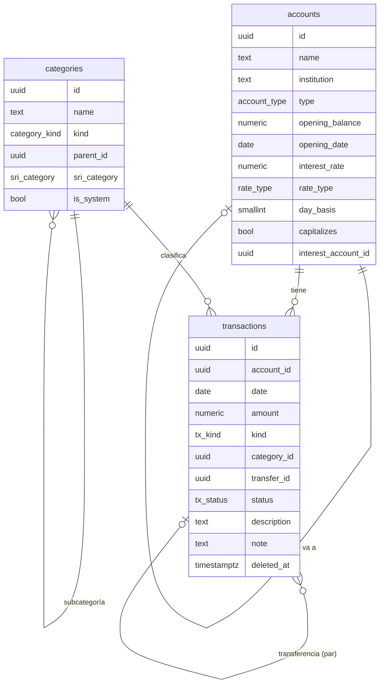

# Esquema de datos · Fase 1 (propuesta)

Núcleo contable: **cuentas, categorías y movimientos** en un libro continuo ([[Preguntas abiertas]] #1). Diseñado para que las fases siguientes ([[Tarjetas de crédito]], [[Créditos y préstamos]], [[Movimientos recurrentes]], [[Facturas y gastos deducibles]]) se añadan sin rehacerlo.

> [!info] Estado: **propuesta**, pendiente de aprobación. No hay código escrito.

## Diagrama

## Principios
1. **Un movimiento = una fila.** Se guarda, edita o borra solo esa fila (adiós a "borrar y reinsertar el año": B6, B10, B12 quedan resueltos).
2. **Monto con signo**: positivo entra a la cuenta, negativo sale. Así el saldo es una simple suma:
   $$\text{saldo} = \text{saldo inicial} + \sum \text{montos}$$
3. **Transferencia = 2 filas** (una negativa en la cuenta origen y una positiva en la destino) unidas por `transfer_id`. No tienen categoría, por eso **no cuentan como gasto ni ingreso**.
4. **Tarjeta de crédito = una cuenta más**, de tipo `tarjeta_credito`: los consumos son montos negativos (la deuda es el saldo negativo) y pagarla es una transferencia desde el banco. Encaja directo con la fase 3.
5. **Montos exactos**: `numeric(14,2)` en la base; en la app se calcula en **centavos enteros** y se redondea solo al mostrar ([[Reglas generales]]).
6. **Borrado suave**: eliminar marca `deleted_at` (papelera); el borrado definitivo pide confirmación.
7. **Seguridad**: RLS por usuario en todas las tablas, y claves compuestas `(id, user_id)` para que un movimiento no pueda apuntar a la cuenta o categoría de otro usuario (lección de C17).

## Tablas

### `accounts` (cuentas)
| Columna | Tipo | Notas |
|---|---|---|
| id, user_id | uuid | |
| name | text | obligatorio |
| institution | text | banco o institución |
| type | enum | corriente · ahorro · efectivo · tarjeta_credito · inversion · poliza |
| currency | text | `USD` fijo ([[Preguntas abiertas]] #3) |
| opening_balance | numeric(14,2) | saldo al empezar a registrar |
| opening_date | date | desde cuándo cuenta ese saldo |
| interest_rate | numeric(8,4) | % anual; solo ahorro, inversión y póliza |
| rate_type | enum | nominal · efectiva |
| day_basis | smallint | 360 o 365 (#6) |
| capitalizes | bool | si el interés se suma a la misma cuenta (#4) |
| interest_account_id | uuid | cuenta destino si no capitaliza (#4) |
| credit_limit, statement_day, due_day | | solo tarjetas: cupo, día de corte, día máximo de pago |
| color, sort_order | | presentación |
| archived_at | timestamptz | ocultar sin borrar |

### `categories` (categorías)
| Columna | Tipo | Notas |
|---|---|---|
| id, user_id | uuid | |
| name | text | editable |
| kind | enum | ingreso · gasto |
| parent_id | uuid | subcategorías opcionales |
| sri_category | enum | vivienda · salud · educacion · alimentacion · vestimenta · turismo (null = no deducible por defecto) |
| is_system | bool | p. ej. "Rendimientos financieros": no se puede borrar |
| color, icon, archived_at | | |

### `transactions` (movimientos)
| Columna | Tipo | Notas |
|---|---|---|
| id, user_id | uuid | |
| account_id | uuid | cuenta afectada |
| date | date | fecha real |
| amount | numeric(14,2) | con signo; nunca 0 |
| kind | enum | ingreso · gasto · transferencia · ajuste |
| category_id | uuid | obligatorio salvo transferencias |
| transfer_id | uuid | une las 2 filas de una transferencia |
| status | enum | confirmado · pendiente (el "Pagado/Pendiente" de hoy) |
| description, note | text | nota opcional |
| deductible | bool | se marca como deducible (fase 5 añade la factura) |
| legacy_ref | text | de qué registro viejo vino (trazabilidad de la migración) |
| created_at, updated_at, deleted_at | timestamptz | |

Reglas en la base (`check`): ingreso ⇒ monto > 0; gasto ⇒ monto < 0; transferencia ⇒ `transfer_id` y sin categoría.

### Vistas y funciones
- `account_balances`: saldo de cada cuenta = inicial + movimientos confirmados no borrados.
- `create_transfer(origen, destino, monto, fecha, descripción)`: crea las 2 filas en **una sola transacción**.
- Resumen: **patrimonio neto** = suma de saldos (las tarjetas restan solas por ser negativas); **ahorros** = cuentas ahorro/inversión/póliza; **disponible** = corriente + efectivo.

### Historial
La tabla `journal` actual se sustituye por un **trigger** que registra automáticamente cada alta, cambio o borrado de `accounts`, `categories` y `transactions` (quién, cuándo, antes y después). Ya no depende de que la app lo escriba.

## Qué pasa con las tablas actuales
- **No se borran.** Quedan intactas (solo lectura) como respaldo, además del Excel previo.
- Fase 1 migra: `payments`, `income`, `savings_accounts`, `savings_entries`.
- Quedan para su fase: `debts` → fase 3 ([[Créditos y préstamos]]); `fixed_budget_*` → fase 2 (recurrentes) y fase 4 (presupuestos).

## Migración (borrador)
| Origen (hoy) | Destino | Detalle |
|---|---|---|
| `payments` | `transactions` gasto | categoría por nombre (se crean las 10 categorías existentes); sin fecha → día 1 del mes |
| `income` | `transactions` ingreso | categoría según "origen" (Sueldo Solca, Gensystems…) |
| `savings_accounts` | `accounts` tipo ahorro | saldo inicial = "inicial" de su primera fila |
| `savings_entries` | `transactions` | aporte / retiro / interés por fila |
| Estados | Pagado → confirmado; Pendiente → pendiente | |

Los puntos dudosos de la migración están en la sección siguiente.

> [!important] Cambio de decisión (2026-10-20, tras ver la vista previa): **no se migra el historial**. Se empieza de cero: cada cuenta arranca el 2026-10-20 con su saldo real como saldo inicial (`supabase/inicio_fase1.sql`, ya ejecutado). El historial anterior queda en las tablas antiguas y en `respaldos/`. `supabase/migracion_fase1.sql` queda como referencia. Las decisiones de abajo aplicarían solo si algún día se migra.

## Decisiones de migración (2026-10-20)
1. ✅ **Cuentas reales**: el usuario indica sus cuentas y el saldo de hoy de cada una; los movimientos se asignan a ellas y el saldo inicial se calcula para que hoy cuadre exacto: inicial = saldo de hoy − suma de movimientos migrados.
2. ✅ **Solo se migran los pagos/ingresos "Pagado"**. Los pendientes generados por el presupuesto fijo no se migran: el presupuesto fijo se convierte en [[Movimientos recurrentes]] en la fase 2.
3. ✅ **"Pago tarjeta" → transferencia** hacia una cuenta tipo tarjeta de crédito (no gasto).
4. ✅ **Ahorros**: los depósitos/retiros son **transferencias** desde/hacia la cuenta principal; los intereses son ingreso "Rendimientos financieros" en la cuenta de ahorro. Se revisa que los ingresos "Interés Guayaquil" no dupliquen esos intereses.

5. ✅ Pagos con categoría **"Pichincha"** = pago de la tarjeta → transferencia a la tarjeta.
6. ✅ Ingresos con origen **"Pichincha"** = intereses de la cuenta → ingreso "Rendimientos financieros".
7. ✅ Aportes al **Fideicomiso Extraordinario** = **descuento de rol** → ingreso directo al fideicomiso (no restan de Pichincha).
8. ✅ **Cuenta principal**: Pichincha Ahorros (de ahí salen los pagos y ahí llega el sueldo).

### Cuentas reales (2026-10-20; los saldos no se publican en el repo)
| Cuenta | Tipo | Institución | Saldo hoy | Notas |
|---|---|---|---|---|
| Pichincha Ahorros | ahorro | Banco Pichincha | (privado) | **principal** |
| Metas | ahorro | Banco Guayaquil | (privado) | era "Metas Guayaquil" |
| Tarjeta Pichincha | tarjeta_credito | Banco Pichincha | (privado) | corte día 23 · pago máximo día 8 |
| Anefi Patronal | inversion (fideicomiso) | Anefi | (privado) | |
| Anefi Personal | inversion (fideicomiso) | Anefi | (privado) | |
| Anefi Extraordinaria | inversion (fideicomiso) | Anefi | (privado) | era "Fideicomiso Extraordinario" |

Tasas de interés: pendientes (se completan desde la app).

### Cómo cuadran los saldos
El historial registrado no cubre todo (algunas cuentas tenían movimientos sin registrar). En lugar de esconder la diferencia en el saldo inicial, la migración:
1. usa como **saldo inicial** el primer saldo conocido de cada cuenta (o 0 si no hay historial),
2. migra los movimientos,
3. crea **un movimiento "Ajuste de migración"** con fecha de hoy por la diferencia hasta el saldo real.

Así cada número se puede explicar ([[Reglas generales]]). Por esto `transactions.kind` incluye el valor **`ajuste`** (no cuenta como ingreso ni gasto).

### Datos de tarjeta en la fase 1
Para no perder cupo, día de corte y día de pago, `accounts` lleva columnas opcionales `credit_limit`, `statement_day` y `due_day` (solo para tarjetas). La lógica completa llega en la fase 3.
